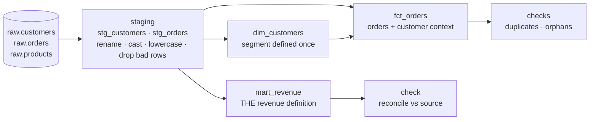

# SQL Analytics & Data Modeling

**Plain-SQL analytics engineering over an orders / customers / products dataset: staging models that clean each source, a star schema (`dim_customers`, `fct_orders`) and an official revenue mart, CTE pipelines, window-function metrics, and data-quality checks that catch duplicated or dropped revenue.**

Raw application tables are normalized for writes, not for questions like "revenue by region and tier this month." This project builds the layers in between, each with one job, so a number on a dashboard can be traced back through a mart to its source.



## Contents

| File | What it shows |
|---|---|
| `sql/sources.sql` | Normalized source tables |
| `sql/staging/` | One model per source: standardized tier and status casing, typed dates, corrupt rows removed — no joins, no business logic |
| `sql/marts/dim_customers.sql` | Customer dimension with a tier-derived segment (`strategic` / `growth` / `self-serve`) defined in one place |
| `sql/marts/fct_orders.sql` | Fact table at order grain, joined to the dimension for region and segment |
| `sql/marts/mart_revenue.sql` | Paid revenue and order count by region and tier — the single revenue definition |
| `sql/enriched_orders.sql` | A CTE pipeline: filter, then enrich with customer and product context (`COALESCE` for unknown categories) |
| `sql/daily_summary.sql`, `sql/monthly_summary.sql` | Daily and `YYYY-MM` roll-ups |
| `sql/region_metrics.sql` | Window functions: running total, 3-day moving average, share of region total, `NTILE` quartiles |
| `sql/checks/` | Violation queries (duplicate orders, orphaned customers) that pass when empty, and a source-vs-mart revenue reconciliation |

[MODELING.md](MODELING.md) explains the layering; [QUALITY.md](QUALITY.md) explains the check conventions.

## Example run

The queries use SQLite syntax (`strftime`, `DATE`) and expect the sources in a schema named `raw`. On a six-order sample — including one order with upper-case `PAID` status and one whose customer doesn't exist — the outputs are:

```text
mart_revenue
  AMER  enterprise  2 orders  150.0
  AMER  smb         1 order    40.0
  EMEA  mid         1 order    80.0

checks/duplicates          → no rows (pass)
checks/orphan_customers    → no rows (pass)
checks/reconcile_revenue   → source 220.0  mart 270.0  difference -50.0  (fail)
```

The reconciliation is the check doing its job: it exposes two real inconsistencies that the other checks miss (see below).

## Known issues

- **Status casing differs between layers.** Staging lowercases `status`, but the reconciliation's source side and `enriched_orders` (which feeds the daily, monthly, and window-function queries) filter raw `status = 'paid'`, so an order stored as `PAID` counts in the mart but not in those queries.
- **The orphan check can't find orphans.** It looks for orders without a customer in `fct_orders`, but `fct_orders` is built with an `INNER JOIN`, so orphaned orders are already silently dropped. Checking `stg_orders` against `dim_customers` would catch them.
- There's no runner or seed data; models must be created in dependency order by hand (e.g. as tables or views), and the `raw.` schema prefix needs a database that supports it.
